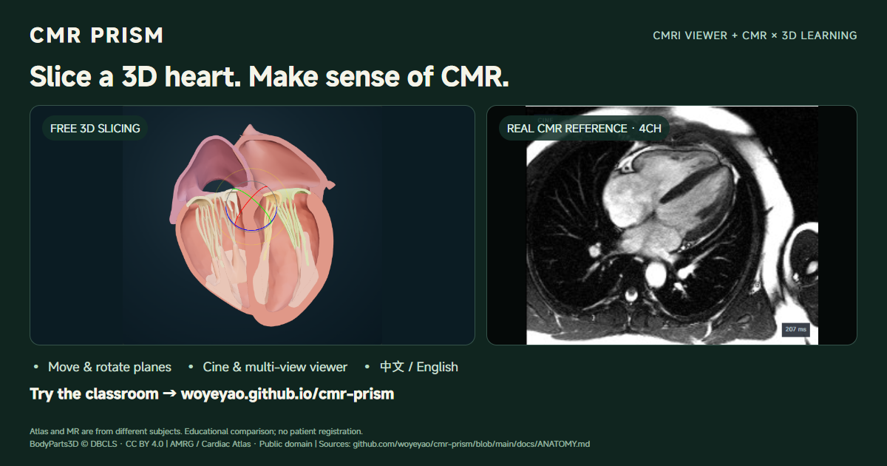

# CMR Prism · 心磁棱镜

**A cardiac MRI (CMRI) viewer and an interactive CMR × 3D anatomy tutorial.**

English · [简体中文](README.zh-CN.md)

[**Try the anatomy classroom**](https://woyeyao.github.io/cmr-prism/) · [Source on GitHub](https://github.com/woyeyao/cmr-prism)

[](https://woyeyao.github.io/cmr-prism/)

Public atlas and AMRG reference captures; [image credits](public/social-preview.txt).

Read cardiac MR in space and time. Cut through a 3D heart to explore its anatomy, then compare the resulting section with real CMR references. CMR Prism brings two connected workspaces together:

| Workspace | What you can do | Where it runs |
| --- | --- | --- |
| **CMRI viewer** | Import DICOM, play cine, adjust window/level, compare sequences, and arrange acquired planes in 3D | Locally, with your own images |
| **CMR × 3D tutorial** | Explore guided planes, freely move and rotate a cutting plane, and compare 3D anatomy, colored sections and real CMR | Online without installation, or inside the local viewer |

## Highlights

- **Cut the model yourself.** Drag translation axes and rotation rings directly in 3D. Set XYZ coordinates, angles or a plane normal; retain either side of the cut, show the whole heart or inspect the section alone.
- **Connect the views.** In guided mode, one plane drives the 3D cut, colored 2D section and locator. Compare them with public MR/cine references, or choose a local DICOM series beside the model.
- **Read CMR across space and time.** Use a slice atlas, single-image view, 2–4 linked viewports, or a spatial cube containing 2–5 acquired planes. Navigate slice position and time independently.
- **Work with two anatomical atlases.** BodyParts3D and the HRA female heart provide complementary structures and their own candidate teaching planes.
- **Arrange the desktop workspace.** Resize panels, expand references, switch themes and choose English or Chinese. CMR images keep their physical aspect ratio as panels grow.
- **Keep local images local.** Import folders, files or ZIP archives through a service bound to your computer. The public site contains only the supplied atlas and reference assets.

## Get started

**For the tutorial:** [open the online classroom](https://woyeyao.github.io/cmr-prism/). No DICOM import is needed. Choose **English** in the toolbar.

**For the full viewer:** install Node.js 22 or 24 and use a modern desktop browser with WebGL2. No separate Python, ITK or VTK installation is required.

```powershell
npm ci
npm run dev
```

Open [127.0.0.1:3001](http://127.0.0.1:3001). For production use, run `npm run build`, then `npm start`. The service binds only to the local address.

## Explore CMR × 3D

1. Choose **BodyParts3D** or **HRA female heart**, then a localizer, long-axis, short-axis or outflow view. Each model uses its own candidate plane; unavailable presets are identified.
2. Rotate and zoom the heart, or use **Face plane** to inspect the cut. Toggle the two sides, section fill, blood pools, vessels and individual structures.
3. Compare the colored section and locator with the **CMR reference**. Play cine, enlarge the reference or resize its panel. Local images account for PixelSpacing; widening the panel increases image height proportionally. Vertical dragging adds extra height, and double-clicking the separator restores the proportional height.
4. Open plane adjustments to translate along XYZ, offset along the normal or tilt the plane. The 3D cut, section and locator update together. Reset or export the plane parameters.

### Free slicing

Choose **Free slicing** for a dedicated 3D workspace. Drag an axis to move the plane or a ring to rotate it about its current center. Numeric positions have no preset range restriction; angles can exceed a full turn, slider ranges can expand, and the normal can be entered directly. Export the resulting plane or restore its starting reference.

| Shortcut | Action |
| --- | --- |
| `G` | Move the cutting plane |
| `R` | Rotate the cutting plane |
| `Esc` | Explore the model without editing the plane |

Guided and free editing are independent. Switching between these modes initializes the selected mode's editing state.

**The atlas and reference MR come from different subjects.** Their connection is an anatomical teaching comparison, not patient-specific registration, synchronized cardiac motion or pixel correspondence. Moving the model's plane does not reslice the MR. Teaching presets remain candidates for independent review; open contours are not filled as tissue. Geometry, coverage and sources are documented in [ANATOMY](docs/ANATOMY.md).

## Use the CMRI viewer

Import a folder, multiple files or a ZIP, or drop files into the window. Include the needed sequences from one examination; a new import replaces the current examination. Personal samples can be kept beside the project in `../cmr-eg` and are not distributed with it.

| View | Use |
| --- | --- |
| Slice atlas | Survey slices in 3D, adjust their displayed spacing, and open an individual image |
| Single image | Adjust window/level, pan and zoom, inspect acquisition information and add temporary notes |
| Split view | Compare 2–4 sequences with same-study locator lines and optional cine phase linking |
| Spatial cube | Compare 2–5 acquired planes in their DICOM spatial coordinates |

To build a spatial cube, choose a series and slice in each split viewport, then click **+** in its toolbar. After adding at least two planes, choose **Spatial cube**. Adding the same plane again removes it. Selected planes must have reliable geometry and belong to the same study and Frame of Reference; cine updates the image shown on each selected plane.

| Control | Action |
| --- | --- |
| Wheel / Left or Right arrow | Change the time frame; manual changes pause playback |
| Shift + wheel / Up or Down arrow | Change the spatial slice |
| Space | Play or pause; frame rate is adjustable from 1–60 fps |
| Image left drag / Ctrl + wheel | Pan / zoom around the pointer; **Fit** resets the view |
| Double-click a split image | Enlarge the active viewport; returning preserves its state |
| 3D left drag / Shift + left drag or right drag | Rotate / pan |
| Side-panel arrows | Collapse the directory or parameter panel |

Focus an image before using viewer shortcuts. Inputs, notes and selects do not trigger global navigation; the classroom has separate controls. Cine linking uses normalized cardiac phase and marks approximate matches with **≈**. LGE, perfusion and mapping can be browsed frame by frame; parameter samples are not treated as cine. Series labels and compatible stacks can be organized without rotating pixels or registering images.

## Data and current scope

- Supports classic MR and uncompressed integer Enhanced MR. Compressed classic single-frame MR uses ITK-Wasm. Compressed multiframe MR, floating-point MR, standalone Parametric Map, NIfTI, ROI and quantitative analysis are not yet implemented.
- Local images are not sent to external services. Frames load on demand, with a 128 MiB client pixel cache and bounded background prefetch.
- Sessions, notes and plane selections are temporary. Closing or replacing a study releases its session; cancellation cleans up after active file operations finish. Idle sessions expire after 30 minutes. Force-stopping the server may leave temporary files.
- The UI retains theme and language preferences. A 3D failure still leaves 2D browsing available. Theme changes do not alter grayscale pixels.
- The interface targets desktop use. The online classroom has no upload endpoint or local-study API.

## Sources and attribution

| Resource | Credit and source |
| --- | --- |
| BodyParts3D v4.0 | © The Database Center for Life Science, **CC BY 4.0**. [Official downloads](https://dbarchive.biosciencedbc.jp/en/bodyparts3d/download.html) · [License](https://dbarchive.biosciencedbc.jp/en/bodyparts3d/lic.html) |
| HRA female heart and vasculature v1.3 | Kristen Browne and Heidi Schlehlein, **CC BY 4.0**. [Heart](https://doi.org/10.48539/HBM449.SHRV.225) · [Vasculature](https://doi.org/10.48539/HBM322.KKFC.394) |
| AMRG reference MR | Auckland MRI Research Group, Auckland, New Zealand; **public domain**. [Cardiac atlas](https://www.cardiacatlas.org/amrg-cardiac-atlas/) · [Public-domain statement](https://www.cardiacatlas.org/) |

Meshes are derived teaching assets, including simplification, cropping and coordinate quantization. Exact transformations, attribution and file hashes are recorded in [ANATOMY](docs/ANATOMY.md) and [the asset manifest](public/anatomy/provenance.json). [CardioAtlas](https://kalanimd.com/cardio-atlas/index.html) informed interaction and orientation review; its site code was not copied. Private studies and their screenshots are not included in the repository.

## Development and deployment

Checks: `npm run typecheck`, `npm test`, `npm run test:e2e`, `npm run build`. Source geometry: `npm run verify:aorta`. Optional local sample verification: `npm run verify:sample`. Before publication: `npm run audit:publication`.

For the static classroom, run `npm run build:pages`, then `npm run verify:pages`. Output is `artifacts/pages`, with `/cmr-prism` as the default URL prefix. Stop the local service before a static build; run the normal build again before restarting the full local viewer. GitHub Actions checks and publishes the static classroom when `main` changes. Both entries share the same classroom components.

| Documentation | Contents |
| --- | --- |
| [ANATOMY](docs/ANATOMY.md) | Models, plane geometry, review limits and sources |
| [ARCHITECTURE](docs/ARCHITECTURE.md) | Module contracts, coordinates and lifecycle |
| [SEQUENCES](docs/SEQUENCES.md) | DICOM sequence recognition and local samples |
| [VALIDATION](docs/VALIDATION.md) | Executed checks and remaining coverage |
| [PROJECT](docs/PROJECT.md) / [ROADMAP](docs/ROADMAP.md) | Implemented capabilities and next steps |
| [DEVELOPMENT](docs/DEVELOPMENT.md) / [PUBLICATION](docs/PUBLICATION.md) | Maintenance, assets, cleanup and publishing |
| [CHANGELOG](CHANGELOG.md) | Version history |

The README is available in full in both languages. Detailed engineering documents are currently mainly in Chinese.

Sharing: [post copy and outreach notes](docs/SHARING.md) (Chinese / English).
