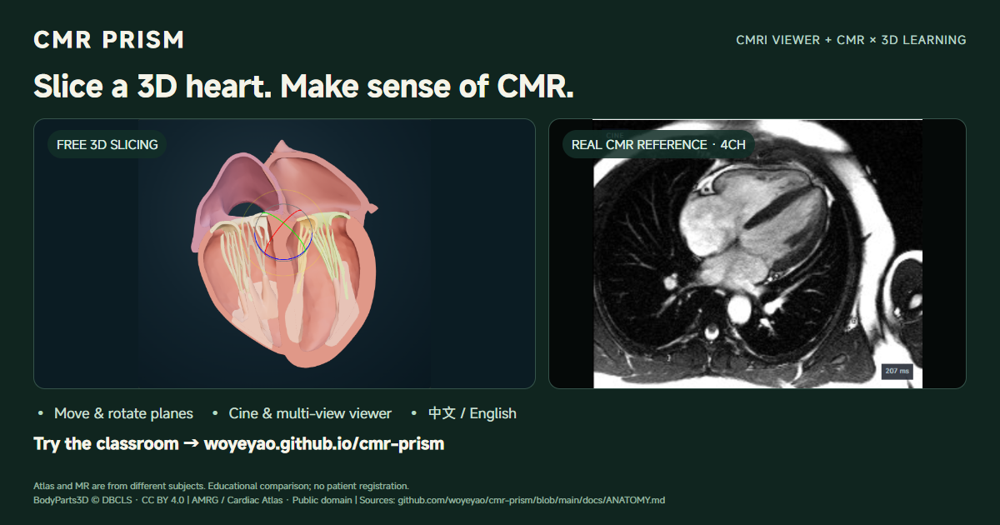

# CMR Prism · 心磁棱镜

**CMRI 阅片工作台，也是把 CMR 与 3D 心脏模型联系起来的交互教程。**

[English](README.md) · 简体中文

[**打开在线解剖课堂**](https://woyeyao.github.io/cmr-prism/) · [项目源码](https://github.com/woyeyao/cmr-prism)

[](https://woyeyao.github.io/cmr-prism/)

配图为公开图谱与 AMRG 参考影像实拍，见[来源与署名](public/social-preview.txt)。

在时间与空间中查看心脏磁共振，亲手切开三维心脏，再对照真实 CMR 理解断面解剖。CMR Prism 将两种工作区放在同一个项目里：

| 工作区 | 可以做什么 | 在哪里使用 |
| --- | --- | --- |
| **CMRI viewer** | 导入 DICOM、播放 Cine、调窗、多序列比较，把采集平面放入三维空间 | 在本机查看自己的影像 |
| **CMR × 3D 交互教程** | 浏览课程切面，自由移动、旋转切面，对照三维解剖、彩色断面和真实 CMR | 在线免安装，也可在本机查看器中使用 |

## 项目特点

- **亲手切开模型。** 在三维视图中直接拖轴平移、拖环旋转；也可输入 XYZ、角度或法线，保留切面任一侧、查看整心或只显示断面。
- **把几个视图联系起来。** 课程模式中，同一切面驱动三维切口、二维彩色断面和定位线；旁边可对照公开 MR／Cine，也可选择自己的 DICOM 序列。
- **同时理解时间与空间。** 阅片支持玻璃阵列、单张、2–4 分屏及含 2–5 个采集平面的空间立方体，时间帧与空间层位独立导航。
- **两套解剖图谱。** BodyParts3D 与 HRA 女性心脏提供不同的结构覆盖，各标本使用自己的候选教学切面。
- **可调整的桌面工作区。** 拖动分隔条、放大对照图、切换深浅主题与中英文；CMR 随面板宽度按物理比例增高。
- **本机影像留在本机。** 通过仅绑定本机地址的服务导入文件夹、文件或 ZIP。在线版只包含随项目提供的公开图谱及参考影像。

## 开始使用

**体验教程：** [直接打开在线课堂](https://woyeyao.github.io/cmr-prism/)，无需导入 DICOM。顶部可切换 English／中文。

**使用完整阅片工作台：** 安装 Node.js 22 或 24，使用支持 WebGL2 的现代桌面浏览器。无需单独安装 Python、ITK 或 VTK。

```powershell
npm ci
npm run dev
```

打开 [127.0.0.1:3001](http://127.0.0.1:3001)。生产运行用 `npm run build`，再执行 `npm start`；服务只绑定本机地址。

## 探索 CMR × 3D

1. 选择 **BodyParts3D** 或 **HRA 女性心脏**，再选择定位、长轴、短轴或流出道视图。各模型使用自己的候选切面；缺少预设时明确提示。
2. 旋转、缩放心脏，或用「正对切面」查看切口。两侧组织、断面填色、血池、大血管和单个结构可独立控制。
3. 对照彩色断面、定位图和 **真实 CMR**，播放 Cine、放大对照或调整面板。本机影像考虑 PixelSpacing，拖宽时高度按比例增加；纵向拖动增加额外高度，双击分隔条恢复等比高度。
4. 展开切面微调，沿 XYZ 平移、沿法线偏移或倾斜切面。三维切口、断面和定位线同步变化，可复位或导出参数。

### 自由切面

顶部点击「自由切面」，进入专用三维工作区。拖动轴平移切面，拖动环绕当前切面中心旋转。数值位置不受预设范围限制，角度可超过一整圈，滑块视程可扩展，也可直接输入法线。支持导出当前切面或恢复起始参考面。

| 快捷键 | 操作 |
| --- | --- |
| `G` | 移动切面 |
| `R` | 旋转切面 |
| `Esc` | 观察模型，不编辑切面 |

课程与自由编辑独立，切换模式会初始化所选模式的编辑状态。

**图谱和参考 MR 来自不同受试者。** 两者用于联系和比较解剖，不表示同人配准、心动时相同步或逐像素对应。移动模型切面不会重切 MR。教学切面仍为待独立复核的候选，开放轮廓不填成组织。几何依据、模型覆盖和来源见 [ANATOMY](docs/ANATOMY.md)。

## 使用 CMRI viewer

选择文件夹、多文件、ZIP，或将文件拖入页面。一次导入一份检查所需的序列；新导入会替换当前检查。自己的样例可放在项目旁 `../cmr-eg`，不随项目分发。

| 展示方式 | 用途 |
| --- | --- |
| 玻璃阵列 | 在三维空间概览层位，调整显示间距，打开单张影像 |
| 单张 | 调窗、平移缩放、查看采集信息及添加临时备注 |
| 分屏 | 比较 2–4 个序列，显示同检查定位线，可选 Cine 相位联动 |
| 空间立方体 | 在 DICOM 空间坐标中比较 2–5 个采集平面 |

构建立方体：在各分屏视口选择序列、层位，点击工具栏「＋」；加入至少两个平面后，选择「空间立方体」。同一层再点即移除。所选平面须具有可靠几何，并来自同一检查及同一 Frame of Reference；Cine 播放时更新各平面上的影像。

| 操作 | 行为 |
| --- | --- |
| 滚轮／左右键 | 切时间帧；手动切帧暂停播放 |
| Shift + 滚轮／上下键 | 切空间层位 |
| 空格 | 播放／暂停；帧率可调 1–60 fps |
| 影像左拖／Ctrl + 滚轮 | 平移／围绕指针缩放；「适应」复位 |
| 分屏影像双击 | 放大活动视口；返回时保留状态 |
| 三维左拖／Shift + 左拖或右拖 | 旋转／平移 |
| 侧栏箭头 | 收起目录或参数面板 |

先聚焦影像再使用快捷键。输入框、备注和下拉框不触发全局导航，课堂使用独立控件。Cine 联动按归一化心动周期匹配，近似匹配标「≈」。LGE、灌注和 Mapping 可逐张浏览，不把参数采样当成 Cine。可整理序列标签、合并兼容堆栈，不会因此旋转像素或配准影像。

## 数据与当前范围

- 支持传统 MR 和未压缩整数 Enhanced MR；压缩传统单帧使用 ITK-Wasm。压缩多帧、浮点 MR、独立 Parametric Map、NIfTI、ROI 和定量分析尚未实现。
- 本机影像不发送外部服务，帧按需读取；客户端像素缓存上限 128 MiB，后台预热有并发和预算限制。
- 会话、备注和切片选择是临时状态。关闭或替换检查释放会话；取消导入会等待活动文件操作结束后清理。30 分钟闲置清理兜底，强制终止服务可能留下临时文件。
- 界面保存主题和语言偏好；三维故障时仍可浏览二维。主题不会改变灰度像素。
- 界面面向桌面。在线课堂不提供文件上传或本机病例 API。

## 来源与署名

| 资源 | 署名与网址 |
| --- | --- |
| BodyParts3D v4.0 | © The Database Center for Life Science，**CC BY 4.0**。[官方下载](https://dbarchive.biosciencedbc.jp/en/bodyparts3d/download.html) · [许可](https://dbarchive.biosciencedbc.jp/en/bodyparts3d/lic.html) |
| HRA 女性心脏与血管 v1.3 | Kristen Browne、Heidi Schlehlein，**CC BY 4.0**。[心脏](https://doi.org/10.48539/HBM449.SHRV.225) · [血管](https://doi.org/10.48539/HBM322.KKFC.394) |
| AMRG 参考 MR | Auckland MRI Research Group, Auckland, New Zealand；**public domain**。[心脏图谱](https://www.cardiacatlas.org/amrg-cardiac-atlas/) · [Public-domain 说明](https://www.cardiacatlas.org/) |

网格为经过简化、局部裁剪和坐标量化的教学衍生资源。完整变换、署名和文件哈希见 [ANATOMY](docs/ANATOMY.md) 与 [资产清单](public/anatomy/provenance.json)。[CardioAtlas](https://kalanimd.com/cardio-atlas/index.html) 为交互及方向复核提供参考，未复制其站点代码。仓库不包含私人病例及其截图。

## 开发与部署

常规检查：`npm run typecheck`、`npm test`、`npm run test:e2e`、`npm run build`。源几何核验：`npm run verify:aorta`。可选本机样例检查：`npm run verify:sample`。发布前执行：`npm run audit:publication`。

静态课堂使用 `npm run build:pages`，随后运行 `npm run verify:pages`，输出到 `artifacts/pages`，默认网址前缀为 `/cmr-prism`。构建前停止本机服务；恢复完整阅片工作台前，重新执行普通构建。GitHub Actions 在 `main` 更新时检查并发布静态课堂，两种入口共用课堂组件。

| 文档 | 内容 |
| --- | --- |
| [ANATOMY](docs/ANATOMY.md) | 模型、切面几何、复核边界与来源 |
| [ARCHITECTURE](docs/ARCHITECTURE.md) | 模块契约、坐标与生命周期 |
| [SEQUENCES](docs/SEQUENCES.md) | DICOM 序列识别与本机样例 |
| [VALIDATION](docs/VALIDATION.md) | 已执行检查与待覆盖范围 |
| [PROJECT](docs/PROJECT.md) / [ROADMAP](docs/ROADMAP.md) | 已实现能力与下一步 |
| [DEVELOPMENT](docs/DEVELOPMENT.md) / [PUBLICATION](docs/PUBLICATION.md) | 维护、资产、清理与发布 |
| [CHANGELOG](CHANGELOG.md) | 版本历史 |

README 提供完整中英文版本，详细工程文档目前以中文为主。

宣传资料：[可直接发布的中英文文案与渠道建议](docs/SHARING.md)。
